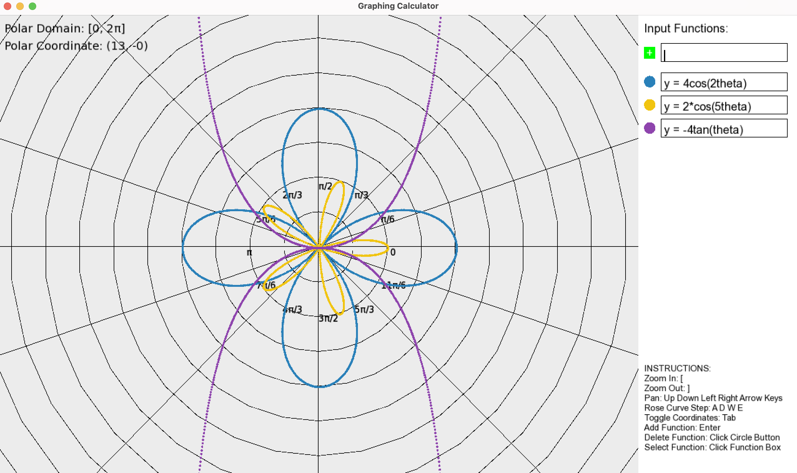
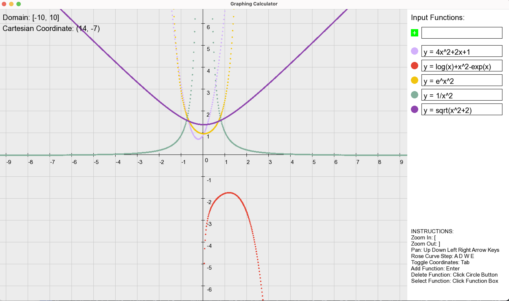
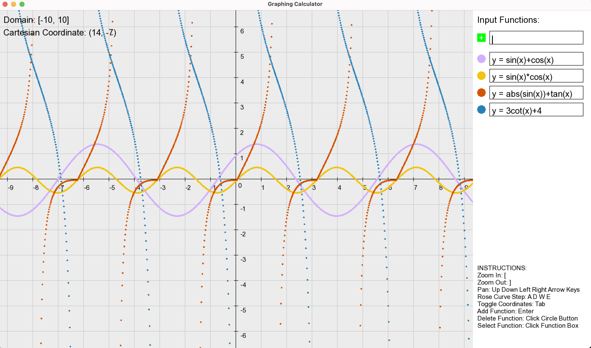

# Work Report

## Name: <ins> Jian Wang </ins>

## Features:

- Not Implemented:
  - Advanced mathematical functions support (e.g., calculus and differential equations )
  - GUI interface enhancements
  - Multithreading for performance improvement
  - 3D Graphic

  

- Implemented:
  - Basic arithmetic operations (addition, subtraction, multiplication, division)
  - Single variable functions (e.g., `sin(x)`, `cos(x)`,`tan(x)`,`cot(x)`)
  - Multi-argument functions (e.g., `Max(a, b)`)
  - Logarithmic and exponential functions (e.g., `log(x)`, `exp(x)`, `e^x^2`)
  - Square root function (`sqrt(x)`)
  - Absolute value function (`abs(x)`)
  - Unary Operations (e.g., `-x` for negation)
  - Rose Curve (e.g., `asin(bθ)` )
  - Expression parsing using the Shunting Yard algorithm 
  - Expression evaluation to generate graph points
  - Coordinate translation (graph coordinates to screen coordinates)
  - Graph drawing (X-axis and Y-axis, plotting points)
  - Switch between polar and Cartesian coordinate modes
  - User interaction features：
    - User interaction features:
    - Zoom In: `[`
    - Zoom Out: `]`
    - Pan: Up, Down, Left, Right Arrow Keys
    - Toggle Coordinates (Polar/Cartesian): `Tab`
    - Add Function: `Enter`
    - Delete Function: Click Circle Button
    - Select Function: Click Function Box

  

- Partly implemented:
  - Complete function handling (limited support for some advanced functions)
  - More refined graph drawing (optimization for details)

  

- Bugs
  - Parsing complex expressions may cause the program to exit
  - High-frequency zoom operations may cause program to exit
  - Interface adaptation issues at extreme resolutions
  

# Reflections:

- This project helped me deepen my understanding of the combination of mathematics and computer science , particularly the Shunting Yard algorithm and RPN expression handling. Implementing this graphing calculator also taught me how to perform graphical drawing and handle user interactions by using SFML, which will be very useful for my future programming project.

# Example Functions and Graphs

## Rose Curve with three variables

Equation: `r = a * sin(b * theta)`

## Polar Functions

Equation: `y = 4 * cos(2 * theta)`
Equation: `y = 2 * cos(5 * theta)`
Equation: `y = -4 * tan(theta)`

## Logarithmic and Exponential Combination

Equation: `y = log(x) + exp(x) - x^2`
Equation: `y = sqrt(x^2 + 2)`
Equation: `y = e^(x^2)`
Equation: `y = 1/x^2`
Equation: `y = 4x^2 + 2x + 1`

## Absolute Value and Sine Function Combination

Equation: `y = abs(sin(x)) + cos(x)`
Equation: `y = sin(x) * cos(x)`
Equation: `y = sin(x) + cos(x)`
Equation: `y = abs(sin(x)) + tan(x)`
Equation: `y = 3 * cot(x) + 4`

# **basic_test.cpp output:**
<pre>
    
----------running basic_test.cpp---------
=====test_shunting_yard_1()=====
Input: 4^ 2 ^ 3

*****SY::ShuntingYard is Fired*****
Postfix Queue:   4  2  3  ^  ^
Test result: 
*****RPN::operator() is Fired*****
65536
=====test_shunting_yard_2()===== 
Input: sin x

*****SY::ShuntingYard is Fired*****
Postfix Queue:   xsin
Test result:  = 
*****RPN::operator() is Fired*****
0.893997
test:sinx

===Test 3: split===

Expression: sinx
Tokens: sinx 
2x+3

===Test 3: split===

Expression: 2x+3
Tokens: 2 * x + 3 
test(sqrt(x) + 5 ^ 2)

===Test 3: split===

Expression: sqrt(x) + 5 ^ 2
Tokens: sqrt ( x ) + 5 ^ 2 

===Test 3: split===

Expression: tan(30) + cot(60)
Tokens: tan ( 30 ) + cot ( 60 ) 

===Test 3: split===

Expression: log(100) % exp(2)
Tokens: log ( 100 ) % exp ( 2 ) 

===Test 3: split===

Expression: abs(-5) + abs(5)
Tokens: abs ( - 5 ) + abs ( 5 ) 

===Test 3: split===

Expression: max(10, 20) + min(5, 10)
Tokens: max ( 10 , 20 ) + min ( 5 , 10 ) 
[==========] Running 0 tests from 0 test suites.
[==========] 0 tests from 0 test suites ran. (0 ms total)
[  PASSED  ] 0 tests.
jwcomputer@JWs-MacBook-Pro bin % 
</pre>

  

# testB.cpp output:
<pre>
    
----------running testB.cpp---------
Running testTranslateMathToScreen...
Math Point: (2, 3)
Screen Point: (610, 20)
Running testGetMathCoordsFromScreen...
Screen Point: (610, -20)
Math Point: (2, 3)
Running testPolarToCartesian...
Polar Coord (r, theta): (5, 0.785398)
Cartesian Coord: (3.53553, 3.53553)
Running testCartesianToPolar...
Cartesian Coord: (3, 4)
Polar Coord (r, theta): (5, 0.927295)
Running testGetPolarCoordsFromScreen...
Screen Point: (510, 180)
Polar Coord (r, theta): (1.41421, 0.785398)
[==========] Running 1 test from 1 test suite.
[----------] Global test environment set-up.
[----------] 1 test from TEST_STUB
[ RUN      ] TEST_STUB.TestStub
[       OK ] TEST_STUB.TestStub (0 ms)
[----------] 1 test from TEST_STUB (0 ms total)

[----------] Global test environment tear-down
[==========] 1 test from 1 test suite ran. (0 ms total)
[  PASSED  ] 1 test.
</pre>

