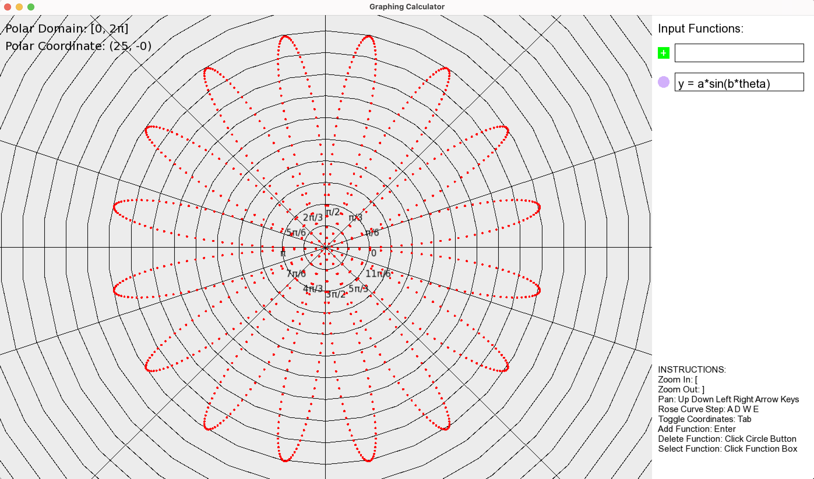
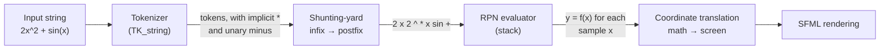

# SFML Graphing Calculator

An interactive graphing calculator written in C++17 with SFML. Type a
function, press Enter, and it is parsed, evaluated, and plotted in Cartesian or
polar coordinates. The expression engine (tokenizer, shunting-yard parser, RPN
evaluator) and its stack and queue are implemented from scratch.



## Features

- **Expressions:** `+ - * / ^ %`, unary minus, parentheses, implicit
  multiplication (`2x`, `3(x+1)`, `(x+1)(x-1)`), constants `pi` and `e`
- **Functions:** `sin cos tan cot sqrt log exp abs`, plus `max(a, b)` and
  `min(a, b)`. `log` is the natural logarithm
- **Cartesian and polar modes:** `y = f(x)` and `r = f(theta)`. Entering a
  function that uses `theta` switches to polar mode automatically
- **Rose curves:** `a*sin(b*theta)` with keyboard control of `a` and `b`
- **Multiple functions** at once, each in its own color; select or delete them
  from the sidebar
- **Zoom and pan** with live re-plotting and a mouse coordinate readout

| Cartesian | Polar |
|---|---|
|  |  |

## How it works



| Module | Path | Role |
|---|---|---|
| Tokenizer | `includes/token/tk_string.*` | Splits input into numbers, variables, functions, operators and parentheses; inserts implicit `*` and marks unary minus |
| Shunting-yard | `includes/shunting_yard/` | Converts infix to postfix using precedence (`+ -` < `* /` < `^`) and associativity (`^` is right-associative) |
| RPN evaluator | `includes/rpn/` | Evaluates the postfix queue with a stack for a given `x` (or `theta`) |
| Plot | `includes/plot.*` | Samples the domain (1000 points), evaluates every function, converts to screen coordinates |
| Coordinate translation | `includes/coord_translation.*` | Math ↔ screen and polar ↔ Cartesian conversions, including zoom and pan |
| UI | `includes/animate.*`, `sidebar.*`, `graph.*`, `polar.*` | Event loop, input box, axes, grid, labels |
| Containers | `includes/stack/`, `includes/queue/` | Linked-list stack and queue used by the parser |

Points are re-evaluated only when something that affects them changes (the
function list, zoom, pan, mode, or `a` / `b`), so an idle frame does no
evaluation work.

## Build and run

Requirements: CMake 3.14+, a C++17 compiler, and **SFML 2.5 or 2.6** (SFML 3
has a different API). GoogleTest is downloaded automatically.

```bash
# macOS: Homebrew's "sfml" formula is SFML 3, so install sfml@2
brew install sfml@2
# Ubuntu / Debian
sudo apt install libsfml-dev

git clone https://github.com/Jean716/sfml-graphing-calculator.git
cd sfml-graphing-calculator
cmake -S . -B build
cmake --build build -j
./build/bin/main
```

Run `./build/bin/main --verbose` to print the full trace of tokenizing,
parsing, and evaluating every point. The UI font (DejaVu Sans) is bundled in
`assets/fonts/`.

## Controls

| Action | Key |
|---|---|
| Add the typed function | Enter |
| Zoom in / out | `]` / `[` |
| Pan | Arrow keys |
| Toggle Cartesian / polar | Tab |
| Rose curve: increase / decrease `a` | `V` / `F` (while the input box is empty) |
| Rose curve: increase / decrease `b` | `G` / `D` (while the input box is empty) |
| Select a function | Click its box in the sidebar |
| Delete a function | Click its colored circle |

Example inputs: `sin(x)*cos(x)`, `x^2/4 - 2`, `sqrt(x^2 + 2)`, `e^(x^2)`,
`3cos(2theta)`, `a*sin(b*theta)`.

## Testing

```bash
cd build
ctest --output-on-failure
```

| Suite | What it checks |
|---|---|
| `expression_test` | End-to-end evaluation (string → tokens → postfix → value) against `<cmath>`: precedence, associativity, implicit multiplication, unary minus, functions, constants, and rejection of invalid input |
| `coord_test` | Math ↔ screen translation, math → screen → math round trips, and polar ↔ Cartesian conversion |

## Background

Built as the final project for CS 3A at Pasadena City College. After the course, the
build was made portable (macOS and Linux), the font was bundled, plotting was
changed to re-evaluate only when inputs change, and the test suites were
rewritten with real assertions.
